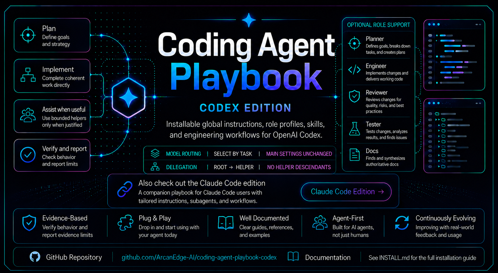

<p align="center">
  
</p>

<h1 align="center">Coding Agent Playbook — Codex Edition</h1>

<p align="center">
  <strong>Give Codex a disciplined, direct-first engineering operating model.</strong>
</p>

<p align="center">
  An open-source Codex playbook for installable instructions, self-contained skills, sparingly used, task-appropriate subagents, independent review, and validation.
</p>

<p align="center">
  <a href="#install-with-one-prompt">Install</a> ·
  <a href="#the-operating-model">Operating Model</a> ·
  <a href="#quick-start">Quick Start</a> ·
  <a href="#harness-editions">Harness Editions</a> ·
  <a href="#why-this-exists">Why This Exists</a> ·
  <a href="#developed-through-real-world-use">Real-World Use</a> ·
  <a href="#public-evidence">Evidence</a> ·
  <a href="#whats-inside">What's Inside</a> ·
  <a href="#role-profiles-and-subagents">Role Profiles</a> ·
  <a href="#formal-task-graph-orchestration">Task Graphs</a> ·
  <a href="#task-local-worktree-lifecycle">Worktrees</a> ·
  <a href="#feature-integration-and-promotion-branches">Branch Lifecycle</a> ·
  <a href="#evidence-based-legacy-path-retirement">Legacy Paths</a> ·
  <a href="#coordinating-parallel-codex-threads">Parallel Threads</a> ·
  <a href="#repository-structure">Structure</a>
</p>

<p align="center">
  
  
  
  
  <a href="https://github.com/ArcanEdge-AI/coding-agent-playbook-claude-code"></a>
  
  
</p>

<p align="center">
  <strong>Using Claude Code instead?</strong>
  <a href="https://github.com/ArcanEdge-AI/coding-agent-playbook-claude-code">Open the Claude Code edition</a>.
</p>

---

## Install with One Prompt

The easiest install path is to give this repo URL to your coding agent:

```text
Install this globally: https://github.com/ArcanEdge-AI/coding-agent-playbook-codex

Follow the repository's INSTALL.md exactly.
Use full mode for this install or update, even if an older installation exists.
Use support-only mode only if I explicitly request it.
Preserve instructions outside the managed section and back up existing files before replacing them.
Install the global instructions, self-contained skills, and supported custom subagents.
Include Intuitive Software Design from the Codex plugin marketplace; reuse the maintained marketplace installation when available.
Report the installed files, backups, preservation warnings, and validation results.
```

That is the intended public experience: users should not need to understand the file layout before installation. The agent should read `INSTALL.md`, clone or fetch the repo, install into user-level Codex/agent configuration locations, validate the result, and report what changed.

Support-only is an explicit pointer-only configuration, not an update mode. Use it only when the user confirms the global instructions already live in Codex Personalization:

```text
Install this in support-only mode: https://github.com/ArcanEdge-AI/coding-agent-playbook-codex

I already added the global custom instructions manually. Follow INSTALL.md, but do not duplicate the full instructions into AGENTS.md. Install self-contained skills and custom subagents only.
```

---

## The Operating Model

The main agent understands the request, inspects the affected flow, implements the smallest complete solution, and verifies the result. It applies relevant skills and can consult a planner, engineer, reviewer, tester, or docs perspective directly when that helps answer a concrete question.

The main agent retains design judgment, task authority, implementation, integration, and final acceptance. Changing perspective preserves its model and reasoning settings and does not require another agent or a separate report. Required independent verification remains a separate obligation.

Use subagents sparingly. Delegate only when a bounded assignment provides independent evidence, parallel progress, or context reduction worth the added coordination and review effort, or a governing requirement calls for independent assistance. Choose an approved model and reasoning effort for the actual task, and inspect the returned evidence.

It installs global instructions, self-contained reusable skills, and custom subagent profiles where Codex supports them. Each skill carries its own supporting references and templates. Try it with the one prompt above, then adapt the repository-level guidance to the codebase in front of you. You may fork, modify, redistribute, and test the approach under the [MIT License](./LICENSE).

---

## Quick Start

### Agent install

Ask your coding agent to install the repo URL and follow `INSTALL.md`. Normal installs and updates use full mode.

### Manual install: macOS / Linux / WSL

```bash
git clone https://github.com/ArcanEdge-AI/coding-agent-playbook-codex.git
cd coding-agent-playbook-codex
python3 install/install.py --full
```

Support-only mode:

```bash
python3 install/install.py --support-only
```

Dry run:

```bash
python3 install/install.py --full --dry-run
```

### Manual install: Windows

```powershell
git clone https://github.com/ArcanEdge-AI/coding-agent-playbook-codex.git
cd coding-agent-playbook-codex
py -3 install/install.py --full
```

Support-only mode:

```powershell
py -3 install/install.py --support-only
```

Dry run:

```powershell
py -3 install/install.py --full --dry-run
```

### Repo-specific guidance

Copy this template into individual projects as a starting point:

```text
skills/reference-doc-routing/references/templates/repository-AGENTS.md
```

Then fill in the actual build commands, test commands, architecture rules, generated-file rules, and release expectations for that repository.

For validation before remote CI, use [Local CI Preflight](skills/local-ci-preflight/SKILL.md). Adapt its [local validation contract](skills/local-ci-preflight/assets/LOCAL_VALIDATION.template.md) to inspected project commands, and merge its [portable agent snippet](skills/local-ci-preflight/assets/AGENTS.local-validation.md) only where equivalent routing is not already present. The supplied contract is intentionally `NOT_CONFIGURED`, not evidence of a passing check.

Run cheap checks before dependent builds and complete affected E2E/native profiles. Reuse existing scripts and runtime ownership; optional workflow emulation is not a required framework migration. Local success does not replace authentic remote acceptance or authorize a push, deployment, or paid run.

---

## Harness Editions

Coding Agent Playbook ships as separate harness-native editions. This repository is the Codex edition.

| Edition | Repository | Use when |
| --- | --- | --- |
| Codex | `ArcanEdge-AI/coding-agent-playbook-codex` | You want global Codex custom instructions, reference docs, skills, and subagent definitions. |
| Claude Code | [`ArcanEdge-AI/coding-agent-playbook-claude-code`](https://github.com/ArcanEdge-AI/coding-agent-playbook-claude-code) | You want the harness-native edition tuned for Claude Code. |

The editions are maintained independently for their respective harnesses. This repository governs only the Codex edition; use the Claude Code repository for Claude-specific behavior and installation.

---

## Why This Exists

AI coding agents are powerful, but they often fail in predictable ways:

- They start coding before understanding the codebase.
- They over-engineer simple requests.
- They invent compatibility requirements for hypothetical users or obsolete test accounts.
- They accumulate tests for abandoned partial fixes instead of maintaining tests for the intended final behavior.
- They refactor unrelated code.
- They trust editor diagnostics over real builds.
- They claim tests passed when they did not run them.
- They delegate poorly or blindly accept subagent output.
- They allow parallel features to develop incompatible contracts or ownership.
- They turn every task into a context dump instead of a focused engineering loop.

This playbook gives Codex a durable operating model:

```text
Understand → Plan → Implement → Verify → Review → Report
```

The intent is not to make the agent slower for its own sake. The intent is to make it **less wrong**, especially on real repositories with existing conventions, local changes, and concurrent work.

---

## Developed Through Real-World Use

The Coding Agent Playbook grew out of ArcanEdge's day-to-day use of coding agents on real software engineering work, not synthetic prompting exercises. ArcanEdge uses these patterns while developing production systems, including work supporting [United Tradesmen](https://www.arcanedge.ai/work/united-tradesmen), a live construction workforce and operations platform, as well as unreleased internal products.

Client and unreleased-product repositories remain private. [ArcanEdge](https://www.arcanedge.ai/) and [United Tradesmen](https://unitedtradesmen.org/) provide the public context; this repository does not publish private source, implementation details, or internal engineering records. The playbook is one part of ArcanEdge's engineering practice, not a claim that AI or this playbook alone built a product.

---

## Public Evidence

Real-world use establishes provenance, but private field evidence is not the public reproducibility layer. [`docs/evidence/`](./docs/evidence/README.md) defines a compact benchmark and run-record format so outside developers can inspect prompts, routing, delegation, review, corrections, validation, and outcomes without needing access to private repositories.

[Benchmark 001](./docs/evidence/BENCHMARK-001.md) has one published measured record: [Benchmark 001 Run 001](./docs/evidence/BENCHMARK-001-RUN-001.md). Its fixture baseline is frozen at [`benchmark-001-baseline-v1`](https://github.com/ArcanEdge-AI/coding-agent-playbook-benchmarks/tree/benchmark-001-baseline-v1) and [exact commit](https://github.com/ArcanEdge-AI/coding-agent-playbook-benchmarks/commit/2a7244f0106cf7f4e106a832b737028144d28389). The run records [Benchmark PR #1](https://github.com/ArcanEdge-AI/coding-agent-playbook-benchmarks/pull/1) as public, open, and unmerged on 2026-08-17; that is historical status, not a current PR-status claim.

The evidence framework makes recorded results inspectable. It does not claim universal cost, token, speed, or quality advantages, or a measured benefit from STE-inspired wording.

---

## What's Inside

| Area | Path | Purpose |
| --- | --- | --- |
| Install guide | `INSTALL.md` | Agent-readable install contract for one-prompt installation. |
| Installer | `install/install.py` | Canonical standard-library Python 3.8+ installer; thin PowerShell and Bash launchers remain available. |
| Global instructions | `custom-instructions/` | Tool-agnostic behavior rules for elegant, maintainable code. |
| Prompts | `codex-prompts/` | Setup and active-project coordination prompts. |
| Skill resources | `skills/*/references/` and `skills/*/assets/` | Supporting guidance and templates packaged with the workflow that owns them. |
| Skills | `skills/` | Self-contained workflows for local CI preflight, task graphs, subagents, worktrees, feature-branch promotion, legacy-path retirement, multi-session coordination, handoffs, session cleanup, doc routing, and senior review. |
| AWS local preflight | [`aws-local-preflight`](skills/aws-local-preflight/SKILL.md) | Moto Server coverage and endpoint isolation for complete local application flows; extends the local CI contract. |
| Repository reviews | [`multi-role-repo-review`](skills/multi-role-repo-review/SKILL.md), [`technical-debt-auditor`](skills/technical-debt-auditor/SKILL.md) | Evidence-backed cross-functional reviews and resumable technical-debt audits. |
| Platform documentation | [`platform-documentation`](skills/platform-documentation/SKILL.md) | Discover behavior from implementation, then write or correct documentation for its readers. |
| Frontend design | [`design-taste-frontend`](skills/design-taste-frontend/SKILL.md), [`impeccable`](skills/impeccable/SKILL.md) | Imported design guidance with supporting resources and upstream attribution. |
| Taste workflows | [`taste-new-website`](skills/taste-new-website/SKILL.md), [`taste-redesign-website`](skills/taste-redesign-website/SKILL.md) | Staged briefs, design approval, implementation, and verification derived from Taste's prompt guide. |
| Writing | [`humanizer`](skills/humanizer/SKILL.md) | Imported guidance for editing AI-generated prose while preserving meaning and voice. |
| Production readiness | [`production-pass-orchestrator`](skills/production-pass-orchestrator/SKILL.md), [`production-readiness-report`](skills/production-readiness-report/SKILL.md), and eleven specialist skills | Evidence-backed assessments, scoped remediation, release gates, and reports across the complete production flow. |
| Companion marketplace plugin | [Intuitive Software Design](plugins/README.md) | The maintained marketplace plugin, providing eight design and evaluation skills; managed separately from standalone skill files. |
| Third-party credits | [`THIRD_PARTY.md`](THIRD_PARTY.md) | Sources, retained licenses, and packaging adaptations for imported skills. |
| Role profiles | `agents/` | Planning, engineering, review, testing, and documentation perspectives for direct main-agent use or bounded subagent assignments with task-based model selection. |
| Repo guidance | `AGENTS.md` | Instructions for maintaining this public playbook repository. |

The standalone collection contains 33 skills. The production specialists are:

| Skill | Focus |
| --- | --- |
| [`production-api-integration`](skills/production-api-integration/SKILL.md) | API contracts and integration failures |
| [`production-architecture-review`](skills/production-architecture-review/SKILL.md) | Architecture and dependency boundaries |
| [`production-code-quality`](skills/production-code-quality/SKILL.md) | Maintainability and code quality |
| [`production-database-integrity`](skills/production-database-integrity/SKILL.md) | Persistence, migration, and data integrity |
| [`production-devops-release`](skills/production-devops-release/SKILL.md) | CI/CD, deployment, and rollback readiness |
| [`production-documentation-onboarding`](skills/production-documentation-onboarding/SKILL.md) | Documentation and developer onboarding |
| [`production-performance-review`](skills/production-performance-review/SKILL.md) | Performance and scalability |
| [`production-reliability-observability`](skills/production-reliability-observability/SKILL.md) | Reliability and operational evidence |
| [`production-security-review`](skills/production-security-review/SKILL.md) | Security and access control |
| [`production-testing-qa`](skills/production-testing-qa/SKILL.md) | E2E coverage and validation confidence |
| [`production-ux-accessibility`](skills/production-ux-accessibility/SKILL.md) | Usability and accessibility |

---

## Install Modes

### Full install

Use this for normal installs and updates. Full mode is the default and safely replaces the playbook-owned marked section and current managed files.

Full install writes a marked section in the user's Codex home `AGENTS.md`, installs self-contained skills and custom subagents, and records their paths and hashes in a manifest. It preserves instructions outside the section. Current managed support files are backed up and replaced when different; retired files are removed only when they match the previous manifest hash. Customized retired files and unrelated files are preserved. See [update behavior](INSTALL.md#full-install) for the conditions.

### Support-only install

Use this only when the user explicitly says the global instructions already live in Codex Personalization → Custom instructions.

Support-only mode avoids duplicating the full instruction file and installs only the self-contained skills, their packaged references, and custom subagents.

---

## Core Philosophy

Understand the whole affected flow and improve the existing implementation by default. A substantial replacement needs evidence of a significant benefit that justifies implementation, migration, verification, and maintenance costs. Preserve suitable components; another possible design or alpha status is not a reason to rebuild.

Retain only end-to-end (E2E) behavioral tests through complete supported UI, API, or CLI flows. Treat every created unit test as temporary, regardless of purpose:

1. Carry its still-required assertions, meaningful failures, and boundary cases into passing E2E coverage. A mocked component check or happy path alone is insufficient.
2. Remove the created unit tests and their exclusively used support code before completion.
3. If replacement coverage or cleanup is incomplete, report unfinished work. Do not declare completion.

Reuse existing E2E coverage and valid results. Build, lint, type checking, required repository gates, supported contracts, and data-preservation safeguards still apply. Migrate existing non-E2E suites only within authorized scope, after replacement coverage passes; do not bulk-delete them.

Write instructions with STE-inspired clarity: direct actions, explicit actors and conditions, and consistent terms. Preserve technical identifiers and consequential exceptions. This is not formal ASD-STE100 compliance and does not impose a restricted dictionary or sentence-length limit.

The main agent is the primary implementer and owns the requested outcome end to end.

It owns:

- task understanding
- the working plan
- architecture and design judgment
- implementation and proportionate decomposition
- any justified delegation and parallel-work coordination
- integration and final acceptance
- final diff
- validation strategy
- final response

The main agent completes coherent work directly by default, including substantial or multi-file work. It uses subagents sparingly, only when a bounded helper's concrete benefit outweighs its context, coordination, latency, and review cost, or governing instructions require independent assistance. Independent project threads may own separate workstreams, but the main coordinating agent still owns compatibility and integration decisions.

> Delegation is optional assistance, not a completion requirement. No direct-execution exception report is needed when no helper is used.

For broad work, the main agent maps bounded work nodes, real blocking dependencies, write ownership or read scope, and verification gates. A graph node is not automatically a helper assignment. When delegation is useful, root sets a finite helper-launch and retry allowance, dispatches only ready work that fits runtime, safety, and ownership capacity, and expands execution cost only for an identified new dependency, invalidated gate, or changed user scope. Real dependencies, verified isolation, and user instructions constrain concurrency; serialize genuine conflicts.

Subagents share the current workspace by default. Worktrees have a separate finite budget that starts at zero; they are created only by the root for a verified isolation need, not per agent. The root may authorize one active auxiliary without additional approval; two or more require user approval for the exact count and reasons. Every task-created auxiliary worktree is integrated and safely removed inside the task or preserved with an exact blocker. No scheduled cleanup task is required for this lifecycle.

---

## Role Profiles and Subagents

The five profiles provide perspectives the main agent can consult directly and roles for bounded subagent assignments. Select one when it helps answer a concrete question; there is no required sequence, separate report per role, or expectation to use all five.

| Profile | Delegated mode | Useful perspective |
| --- | --- | --- |
| `planner` | Read-only | Clarifying outcomes, reuse opportunities, risks, real dependencies, and completion checks. |
| `engineer` | Bounded write | Implementing complete, maintainable changes that fit the existing system. |
| `reviewer` | Read-only | Reviewing diffs, designs, and implementations for correctness, risk, maintainability, and scope discipline. |
| `tester` | Read-mostly | Choosing proportionate checks, evaluating evidence, and diagnosing failures when present. |
| `docs` | Read-only | Finding, interpreting, and summarizing relevant repo docs, reference docs, and authoritative external documentation. |

For direct use, read the relevant `agents/<role>.toml` and apply its **Role perspective** and **Main-agent use** guidance. Preserve the main agent's model, reasoning effort, permissions, approval gates, and ownership.

The profile's launch settings and **Delegated use** section apply only to actual subagents. A reviewer or tester perspective applied to your own work is self-review, not required independent verification.

Select the model and reasoning effort by the actual task, including for retries and replacements. Optimize total completion cost, including tokens, repeated context, corrections, and verification. A low token price alone does not establish efficiency, and a cheap failed attempt is not a prerequisite for using a capable model.

| Work | Model and reasoning |
| --- | --- |
| Narrow lookup, extraction, file mapping, log summaries | GPT-6.1 Sol / Light |
| Clear implementation, local fixes, bounded planning or straightforward review | GPT-6.1 Sol / Medium |
| Coupled changes, difficult debugging, substantial review, conflicting evidence | GPT-6.1 Sol / High |
| Hard architecture questions, persistent debugging, complex cross-system reasoning | GPT-6 Astra / Extra High only |

The app's Light reasoning label uses `low` in TOML; Medium, High, and Extra High use `medium`, `high`, and `xhigh`. High-impact decisions stay with the main agent. Its user-selected model and reasoning remain unchanged unless the user selects otherwise.

Subagents report through team collaboration messaging or a normal final return. They must not alter parent or peer model settings. Any separately authorized task report must omit destination model and reasoning overrides; see `skills/subagent-orchestration/references/model-routing.md` for the execution/reporting boundary.

Each role has one profile with an explicit GPT-6.1 Sol starting default: Docs and Tester use Light, Planner and Engineer use Medium, and Reviewer uses High. Task needs take precedence over those defaults. A custom profile can override spawn arguments, so use a matching profile or a supported explicit route with the same role guidance and safeguards. Verify the effective model and reasoning effort; report unsupported routing rather than silently substituting or inheriting settings. Consult `skills/subagent-orchestration/references/model-routing.md` for selection and acceptance rules. When updating from the retired duplicate profiles, follow the [profile migration note](INSTALL.md#retired-profile-aliases).

The delegation rule is simple:

```text
Precise assignment → Evidence-backed output → Main-agent verification → Accept or reject
```

A good assignment uses six sections: Goal and acceptance, Context, Skills and methods, Scope and authority, Ownership and route, and Return. Include the verified model/effort, exact workspace, finite launch/retry allowance, stop conditions, and required evidence. See the [assignment template](skills/subagent-orchestration/references/subagents.md#assignment-template).

For multi-node work, it also identifies the node, its inputs and accepted output, blocking dependencies, ownership or read scope, and verification gate. The orchestration skill explains fan-out, handoff validation, selective retries, and final combined validation.

### Flat delegation and token economy

Root assigns work directly to helpers, and bundled helpers execute their assignment without spawning descendants. Before dispatch, root records the bounded result, acceptance check, expected benefit, exact workspace, and finite launch/retry allowance. Record the actual root model only when provenance requires it, and verify each helper's effective model and effort match the task-selected route. When capacity is full, continue useful local work or wait; do not queue speculative helpers. Recursive orchestration is outside the default workflow and requires separate explicit authorization and controls.

---

## Formal Task-Graph Orchestration

Use `task-graph-orchestration` for complex work with several independent work items, real dependencies, broad scope, layered consolidation, or separate implementation and verification paths. Record each bounded outcome, the accepted inputs it needs, and its completion check. Execute ready work, combine accepted results, and repeat only work invalidated by a change or failure. Small or linear work may skip the formal graph.

The graph is an instruction and Markdown artifact. It does not add a graph database, scheduler, runner, dependency, or orchestration framework. Medium tasks can keep the graph in the working plan. Long-running, multi-phase, or multi-session implementation may use `.codex/task-graphs/<task-slug>.md` when repository policy permits it.

Supporting files:

```text
skills/task-graph-orchestration/SKILL.md
skills/task-graph-orchestration/references/templates/task-graph.md
```

Run multi-session coordination first when active threads, branches, worktrees, or pull requests may create external ownership or hidden dependency edges. Keep simple or genuinely linear tasks on the normal engineering loop.

---

## Task-Local Worktree Lifecycle

The worktree policy prevents swarm fan-out from becoming checkout fan-out:

```text
Current workspace + auxiliary budget 0
    ↓
Concrete isolation need verified
    ↓
Root issues one finite worktree permit
    ↓
Assigned nodes reuse that exact workspace
    ↓
Root integrates and validates the result
    ↓
Remove safely, or preserve with an exact blocker
```

Only the root may create, adopt, repurpose, move, or remove an auxiliary worktree. It may authorize one active auxiliary without additional approval; two or more require approval for the exact count and reasons. Helpers receive an exact workspace assignment and report any additional isolation need upward. Retries reuse compatible worktrees. Overlapping writers normally serialize because separate checkouts do not remove design or merge conflicts.

Before the final response, the root reconciles every task-created auxiliary worktree. It either verifies safe non-force removal inside the task or reports the exact path, owner, branch or HEAD, blocker, and next action. The workflow does not defer task-owned cleanup to scheduled automation and does not treat host-managed or pre-existing user worktrees as disposable.

Supporting files:

```text
skills/worktree-lifecycle/references/worktrees.md
skills/worktree-lifecycle/references/templates/worktree-manifest.md
skills/worktree-lifecycle/SKILL.md
```

---

## Feature Integration and Promotion Branches

Use `feature-branch-lifecycle` when a feature, change, or update may use one or more development branches in a repository with established long-lived integration and production branches:

```text
development branches
        ↓
feature integration branch
        ↓
integration branch (for example, staging)
        ↓
production branch (for example, main)
```

The feature integration branch is the complete review and validation unit. Development branches converge there, one pull request promotes the accepted feature to the integration branch, and production promotion originates only from the integration branch. Temporary branches are deleted only after verified incorporation, required checks, unique-work and dependency checks, worktree reconciliation, exact-target resolution, and authority for local or remote deletion.

The skill detects actual branch names and repository instructions. It does not invent a missing `staging` branch, replace a repository's selected workflow, or turn branch sequencing into blanket authority for pull requests, merges, remote deletion, or production release.

Supporting files:

```text
skills/feature-branch-lifecycle/SKILL.md
skills/feature-branch-lifecycle/references/branching-rule.md
```

---

## Evidence-Based Legacy Path Retirement

Use `legacy-path-retirement` when an authorized change raises a decision about superseded code, duplicate writers, old contracts, or compatibility fallbacks.

Prefer one authoritative implementation within the affected scope. Retain compatibility only for a demonstrated current dependency or explicit retention requirement; migrate or remove confirmed obsolete paths rather than automatically adding more guards around them. Incomplete dependency coverage is an evidence gap, not proof of non-use.

Code retirement, data disposition, and correctness guarantees are separate decisions. Useful development data may need preservation or migration, destructive resets require authority, and pre-production status does not weaken stable identifiers, authorization, validation, persistence integrity, or cleanup safeguards.

Hypothetical users and obsolete test accounts do not create support commitments. Establish actual retention needs and use existing migration or reset tools when appropriate and authorized, without inventing a second permanent flow to support earlier development versions.

The skill is self-contained in:

```text
skills/legacy-path-retirement/SKILL.md
```

---

## Coordinating Parallel Codex Threads

Subagents are delegated from one main thread. Independent Codex threads may already have separate plans, branches, worktrees, assumptions, and implementation ownership.

Use the multi-session coordination workflow when related project work is happening in parallel:

```text
Current project
    ↓
Threads active within the previous 72 hours
    ↓
Branches, worktrees, pull requests, and unmerged changes
    ↓
Shared change map and conflict detection
    ↓
Ownership, sequencing, and integration verification
```

Repository state takes precedence over recency. Older work still matters when it remains unmerged, incomplete, blocked, contract-relevant, or otherwise active.

New project threads should use this naming format:

```text
Project - Three-to-Four-Word Description
```

Examples:

```text
ArcLedger - Validate Billing Evidence
LoreBound - Implement Campaign Imports
```

The project name should be detected automatically, and the description should be derived from the primary objective. The square brackets used when explaining the format are not part of the actual title.

Start the workflow with:

```text
codex-prompts/coordinate-active-project-work.md
```

Supporting files:

```text
skills/multi-session-coordination/references/multi-session-coordination.md
skills/multi-session-coordination/references/templates/active-work-record.md
skills/multi-session-coordination/SKILL.md
```

The optional active-work record gives repositories a local fallback when direct sibling-thread discovery is unavailable. It is advisory and must be verified against current repository evidence.

---

## Focused Reference Documents

Large documents are useful only when routed correctly.

The main agent should:

1. Identify which docs matter for the task.
2. Read only relevant sections when possible.
3. Classify docs as authoritative, advisory, or historical.
4. Pass only relevant context to subagents or active project threads.
5. Resolve instruction conflicts by authority. Use primary evidence to establish current behavior, not to override the authorized target requirement.

Primary evidence includes current code, tests, schemas, configuration, logs, build output, typecheck output, runtime behavior, and authoritative external documentation.

See:

```text
skills/reference-doc-routing/references/engineering-design.md
skills/subagent-orchestration/references/model-routing.md
skills/reference-doc-routing/references/reference-doc-routing.md
skills/subagent-orchestration/references/subagents.md
skills/multi-session-coordination/references/multi-session-coordination.md
skills/worktree-lifecycle/references/worktrees.md
```

---

## Repository Structure

```text
.
├── .gitattributes
├── AGENTS.md
├── CONTRIBUTING.md
├── INSTALL.md
├── LICENSE
├── README.md
├── THIRD_PARTY.md
├── assets/
│   ├── codex-engineering-team.svg
│   └── coding-agent-playbook-codex-hero.png
├── agents/
│   ├── docs.toml
│   ├── engineer.toml
│   ├── planner.toml
│   ├── reviewer.toml
│   └── tester.toml
├── codex-prompts/
│   ├── coordinate-active-project-work.md
│   └── setup-global-codex-support-system.md
├── custom-instructions/
│   └── global-coding-agent-instructions.md
├── docs/
│   ├── global-instruction-evaluation.md
│   └── evidence/
│       ├── BENCHMARK-001-RUN-001.md
│       ├── BENCHMARK-001.md
│       ├── METHODOLOGY.md
│       ├── README.md
│       └── RUN-TEMPLATE.md
├── install/
│   ├── install.py
│   ├── install.ps1
│   ├── install.sh
│   └── support-only-pointer.md
├── plugins/
│   └── README.md
└── skills/
    ├── design-taste-frontend/
    │   ├── SKILL.md
    │   ├── LICENSE
    │   └── NOTICE.md
    ├── feature-branch-lifecycle/
    │   ├── SKILL.md
    │   └── references/branching-rule.md
    ├── handoff/
    │   ├── SKILL.md
    │   ├── agents/openai.yaml
    │   └── references/context-contract.md
    ├── legacy-path-retirement/
    │   └── SKILL.md
    ├── humanizer/
    │   ├── SKILL.md
    │   ├── LICENSE
    │   └── NOTICE.md
    ├── impeccable/
    │   ├── SKILL.md
    │   ├── LICENSE
    │   ├── NOTICE.md
    │   ├── agents/openai.yaml
    │   ├── reference/
    │   └── scripts/
    ├── local-ci-preflight/
    │   ├── SKILL.md
    │   ├── agents/openai.yaml
    │   └── assets/
    │       ├── AGENTS.local-validation.md
    │       └── LOCAL_VALIDATION.template.md
    ├── multi-role-repo-review/
    │   ├── SKILL.md
    │   └── agents/openai.yaml
    ├── multi-session-coordination/
    │   ├── SKILL.md
    │   └── references/
    │       ├── multi-session-coordination.md
    │       └── templates/active-work-record.md
    ├── platform-documentation/
    │   ├── SKILL.md
    │   ├── agents/openai.yaml
    │   ├── references/
    │   └── scripts/
    ├── production-api-integration/
    │   └── SKILL.md
    ├── production-architecture-review/
    │   └── SKILL.md
    ├── production-code-quality/
    │   └── SKILL.md
    ├── production-database-integrity/
    │   └── SKILL.md
    ├── production-devops-release/
    │   └── SKILL.md
    ├── production-documentation-onboarding/
    │   └── SKILL.md
    ├── production-pass-orchestrator/
    │   └── SKILL.md
    ├── production-performance-review/
    │   └── SKILL.md
    ├── production-readiness-report/
    │   ├── SKILL.md
    │   ├── agents/openai.yaml
    │   ├── assets/report-template.md
    │   ├── references/evidence-lanes.md
    │   └── scripts/validate_readiness_report.py
    ├── production-reliability-observability/
    │   └── SKILL.md
    ├── production-security-review/
    │   └── SKILL.md
    ├── production-testing-qa/
    │   └── SKILL.md
    ├── production-ux-accessibility/
    │   └── SKILL.md
    ├── reference-doc-routing/
    │   ├── SKILL.md
    │   └── references/
    │       ├── README.md
    │       ├── engineering-design.md
    │       ├── reference-doc-routing.md
    │       └── templates/
    │           ├── api-contracts.md
    │           ├── architecture.md
    │           ├── data-model.md
    │           ├── design-system.md
    │           ├── release.md
    │           ├── repository-AGENTS.md
    │           ├── security.md
    │           └── testing.md
    ├── session-cleanup/
    │   ├── SKILL.md
    │   ├── agents/openai.yaml
    │   └── references/post-session-cleanup-methodology.md
    ├── senior-code-review/
    │   └── SKILL.md
    ├── subagent-orchestration/
    │   ├── SKILL.md
    │   └── references/
    │       ├── model-routing.md
    │       └── subagents.md
    ├── task-graph-orchestration/
    │   ├── SKILL.md
    │   └── references/templates/task-graph.md
    ├── taste-new-website/
    │   ├── SKILL.md
    │   ├── agents/openai.yaml
    │   ├── LICENSE
    │   └── NOTICE.md
    ├── taste-redesign-website/
    │   ├── SKILL.md
    │   ├── agents/openai.yaml
    │   ├── LICENSE
    │   └── NOTICE.md
    ├── technical-debt-auditor/
    │   ├── SKILL.md
    │   ├── agents/openai.yaml
    │   ├── assets/
    │   ├── references/
    │   └── scripts/
    └── worktree-lifecycle/
        ├── agents/
        │   └── openai.yaml
        ├── SKILL.md
        └── references/
            ├── worktrees.md
            └── templates/worktree-manifest.md
```

---

## Example: Direct Perspective and Bounded Delegation

The main agent can use a perspective directly:

```text
Apply the reviewer perspective to this diff. Look for incomplete behavior, unnecessary compatibility paths, and redundant tests. Keep working in this chat without launching a subagent, and address in-scope findings under the existing task authority.
```

When a separate helper has a concrete benefit, give it a bounded assignment.

Bad delegation:

```text
Look into this and fix it.
```

Better delegation:

```text
Role:
You are the Planner subagent for this task.

Goal:
Identify the smallest safe implementation plan for adding a customer exemption flag to checkout tax calculation.

Scope:
Inspect checkout, cart, customer, and tax calculation code paths only.

Non-goals:
Do not edit files. Do not refactor. Do not propose a new tax engine.

Evidence required:
Return file paths, function names, likely insertion points, relevant tests, and existing exemption concepts.
```

The main agent still decides the design, applies or rejects recommendations, and verifies the final diff.

---

## Recommended Workflow

```text
1. Ask your coding agent to install this repository URL.
2. Let the installer configure global instructions, self-contained skills with packaged references, and subagents.
3. Add repo-specific AGENTS.md guidance to each project.
4. Let the main agent understand and complete each repository task, consulting a relevant role perspective when useful.
5. Complete coherent work directly; use a helper sparingly when its concrete benefit justifies the overhead, with a bounded root-to-helper assignment and an approved task-selected model and reasoning effort. Helpers execute directly and do not spawn descendants.
6. For multi-node work, identify real blocking dependencies, parallel-safe nodes, ownership, and verification gates. If helpers are used, set a finite launch/retry allowance and dispatch only ready assignments that fit runtime, safety, and ownership capacity; get immediate user approval before materially expanding execution cost.
7. Keep the auxiliary-worktree budget at zero unless root verifies a real isolation need. Before completion, remove each task-created auxiliary worktree safely or preserve it with an exact blocker.
8. When a repository uses long-lived integration and production branches, use the feature-branch lifecycle for development-branch convergence, complete-feature validation, promotion, and authorized cleanup.
9. When independent project threads run in parallel, use the multi-session coordination skill.
10. Verify the final combined diff and integrated behavior before accepting completion.
```

---

## Public Repo Notes

This repository is public so others can star it, fork it, adapt it, and propose improvements.

Please keep contributions generic, reusable, and safe for public use. Do not add private project details, internal URLs, sensitive access material, local machine quirks, or one-off incident logs.

See `CONTRIBUTING.md` for contribution guidance.

---

## License

Original playbook material: MIT © 2026 ArcanEdge AI. See [`LICENSE`](./LICENSE). Imported skills retain their upstream licenses and attribution; see [`THIRD_PARTY.md`](./THIRD_PARTY.md).

---

## Status

This is a living playbook. Treat it as a strong baseline, not a universal law.

The best setup is:

```text
Global behavior + local repository truth + evidence-backed validation
```
